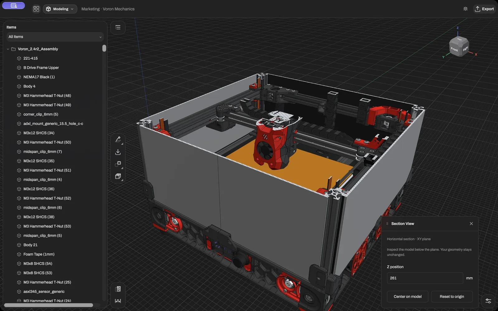
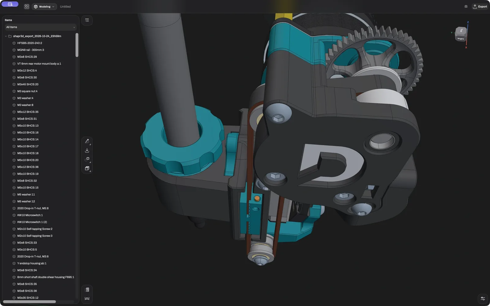

  

<h1 align="center">Bezier</h1>

  Parametric CAD that runs on your own machine. 
  For macOS, Linux and Windows, and in the browser.

  <a href="https://bezier-cad.xyz/download/"><b>Download</b></a> ·
  <a href="https://bezier-cad.xyz">Website</a> ·
  <a href="https://github.com/ProfessorEngineergit/bezier">Source and contributing</a>

---

Hi, and welcome! Bezier is a CAD program for designing real parts. You sketch a shape, pull it
into 3D, round off the edges, and when you later change a dimension, everything after it follows
along. Your model is a history of steps, so changing your mind is never a problem.

There is no account to create and nothing gets uploaded: your projects stay on your computer.

Bezier is still young. It is already useful for real work, and it is still rough in places.

## Download

Get it for macOS, Linux or Windows from [the download page](https://bezier-cad.xyz/download/).
The apps are not signed yet, so your system may ask you to confirm before it opens them.

**A note on Windows.** macOS runs really well, and Linux does too. Windows is the newest and least
tested of the three, so the app there has a lot of extra checks: when something looks off, it
stops and tells you instead of carrying on. You might see a few of those messages in the first
days. If you do, please [let me know](https://github.com/ProfessorEngineergit/bezier/issues/new/choose);
every report helps.

## What it looks like

<table>
  <tr>
    <td width="50%"></td>
    <td width="50%"></td>
  </tr>
  <tr>
    <td></td>
    <td></td>
  </tr>
</table>

## What it can do

- Model with sketches, extrudes, revolves, lofts, sweeps, fillets, chamfers, shells, holes and
  patterns, all in an editable history.
- Make technical drawings, out as PDF or DXF.
- Render with real materials and studio light.
- Simulate static stress on a part.
- Open and save STEP, IGES, STL, OBJ, 3MF, DXF and SVG, large assemblies included.
- Learn with lessons inside the app.
- Keep the keys of the program you already know.

## Help build it

Bezier is open source, and every contribution is welcome, from a bug report to a new feature.
The code, and how to get started, are in
[the source repository](https://github.com/ProfessorEngineergit/bezier).

## License

Free software under the [GNU General Public License v3 or later](LICENSE). The name and logo are
not covered by the license; see [`docs/legal/trademarks.md`](docs/legal/trademarks.md).
