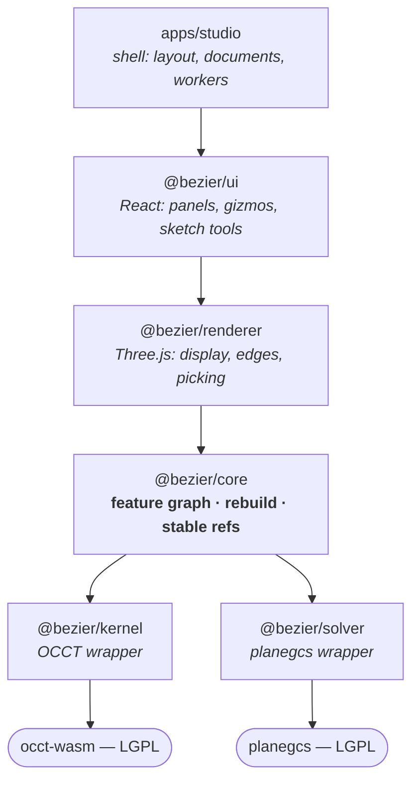

# Architecture

How the pieces fit together, what crosses each boundary, and where the hard
problem lives.

For *why* each choice was made, see [`adr/`](adr).

---

## The shape of it



Three rules hold this together. They are enforced by lint rather than by good
intentions: `biome.json` carries a `noRestrictedImports` override per package, and
a violation fails CI with a message explaining which boundary was crossed.

1. **Dependencies point downward only.** No upward imports, no cycles.
2. **`occt-wasm` is imported only by `@bezier/kernel`. `@salusoft89/planegcs` is
   imported only by `@bezier/solver`.** Both are swappable dependencies carrying
   LGPL obligations; keeping them in one place each means a replacement is a
   contained rewrite and the licence obligations have one home.
3. **No raw kernel handles above `@bezier/core`.** The renderer and UI see our
   vocabulary, never a `ShapeId`.

## What crosses each boundary

### `occt-wasm` → `@bezier/kernel`

OCCT's real API: handles, `TopoDS_*` types, out-parameters, downcasts, manual
memory. All of it stops here.

### `@bezier/kernel` → `@bezier/core`

Down: geometric requests in millimetres, "extrude this profile 5 mm",
"fillet these edges at radius 2".

Up: `KernelResult<T>`, always. Never a thrown exception for a geometry
failure, because geometry failures are normal in every B-Rep kernel and a CAD tool
that treats them as crashes is a CAD tool that loses your work.

Also up, and this is the important one: **`EvolutionData`**, which faces the
operation modified, generated, and deleted. Most applications discard this. It is
the raw material for everything below.

All async: the kernel runs in a Web Worker, because a 400 ms boolean on the main
thread is a frozen cursor.

### `@bezier/solver` → `@bezier/core`

Down: a sketch, 2D primitives and constraints with our own stable string ids.

Up: solved coordinates, plus diagnostics: degrees of freedom, conflicting
constraints, redundant constraints, all mapped back to our ids. Diagnostics are a
first-class return value, not a debugging afterthought, surfacing them well is
one of the clearest ways this can feel better than the free alternatives.

### `@bezier/core` → `@bezier/renderer`

Down: tessellated meshes and extracted edge polylines, as flat typed arrays so
they can be transferred rather than cloned across the worker boundary.

Up: picks, a screen position resolved to a `StableRef`, never a triangle
index. A triangle index is meaningless the moment the model rebuilds.

### `@bezier/renderer` → `@bezier/ui` → `apps/studio`

Plain React props and callbacks. No geometry logic above `core`; if a component
computes something about shape, it is in the wrong layer.

## How one change flows, end to end

The path a single parameter edit takes. Every box is somewhere in this repository.

```mermaid
sequenceDiagram
    participant U as User
    participant UI as @bezier/ui
    participant J as journal
    participant D as disk (OPFS)
    participant C as core (rebuild)
    participant K as kernel worker
    participant R as renderer

    U->>UI: drags fillet radius to 3 mm
    UI->>J: Operation { updateParams }
    J->>D: append entry (checksummed)
    Note over J,D: on disk BEFORE it is applied —<br/>loss is bounded by one operation
    J->>C: apply to document
    C->>C: cache key per feature
    Note over C: features before the edit are hits;<br/>only this one and downstream rebuild
    C->>K: fillet(body, edges, 3)
    K-->>C: shape + EvolutionData
    C->>C: thread face names across the rebuild
    C->>R: mesh + edges (Transferables)
    R->>U: new frame
```

Three properties fall out of this one path, and they are the three requirements
the project is held to:

- **Transparent**, every arrow is a named module with one job.
- **Fast**, the append is the cheapest possible write, unchanged features are
  cache hits, and geometry never touches the UI thread.
- **Redundant**, the operation is durable before it is applied, and if the worker
  dies the supervisor restarts it and replays from the same cache.

They are not three designs traded off against each other. They are one design.
See [ADR 0007](adr/0007-performance-architecture.md),
[ADR 0008](adr/0008-feature-registry.md), and
[ADR 0009](adr/0009-durability.md).

## Where the hard problem lives

**In `@bezier/core`. It is our responsibility, and it is the product.**

### The problem

A user extrudes a sketch, then rounds one edge. Later they change the sketch from
40 mm to 50 mm.

The kernel rebuilds from scratch and returns a solid whose internal numbering
bears no relation to the previous one. Edge #7 is now somewhere else entirely. So:
*which edge did the user mean?*

Get it wrong and the fillet lands on the wrong edge, or the rebuild fails, or -
worst, it silently produces a subtly wrong part. This is the **topological naming
problem**, and the reason "my model exploded when I changed a dimension" is a
familiar complaint about parametric CAD.

### The approach

Name geometry by what created it, never by where it sits.

- A face is named by the feature that produced it plus a tag: *the face
  generated by `extrude-1`, side 3*. Provenance, not position.
- An edge is the intersection of its two adjacent faces.
- A vertex is the set of faces meeting at it.

Deriving edges and vertices from faces is forced, not chosen: OCCT reports
evolution for faces only.

Threading names through a rebuild means following each operation's `EvolutionData`
from the first feature to the last, so a name assigned in step 2 still resolves in
step 4.

The canonical form is implemented and tested in
[`packages/core/src/stable-ref.ts`](../packages/core/src/stable-ref.ts):

```
face    F:extrude-1:side-2
edge    E(F:extrude-1:end|F:extrude-1:side-2)
vertex  V(F:extrude-1:end|F:extrude-1:side-1|F:extrude-1:side-2)
```

Because this text form goes into saved documents, **it is a compatibility
promise**, changing it breaks every file anyone has saved.

### What the experiment showed

Face hashes were the obvious mechanism, and they do not work. Measured against
OCCT 8.0.1 (`tools/spikes/face-hash-stability.ts`, recorded in
[ADR 0001](adr/0001-geometry-kernel.md)):

- an identical rebuild in the same session preserves 0 of 6 hashes
- a parameter change leaves only 1 of 6 faces geometrically unchanged

So neither the kernel's ids nor the geometry itself can be the key. Provenance is
what remains, and it is what the scheme above is built on. Signature survives as
a tie-breaker between siblings sharing a provenance name.

## Rebuilds fail partially, never totally

A rebuild is not all-or-nothing. If the fillet in step 3 fails, steps 1–2 still
produced a solid, and the user still sees their part with a clear marker on the
broken step.

`RebuildResult` therefore carries a per-feature status: `ok`, `failed` (the kernel
refused), `dangling` (a referenced face no longer exists), or `blocked` (something
it depended on failed first). Losing an entire model because one operation failed
is precisely the behaviour that makes free CAD frustrating.

## Threading

| Thread | What runs there |
| --- | --- |
| **Main** | React, the Three.js scene, all interaction |
| **Kernel worker** | OCCT. Everything geometric. |
| Solver | Main thread for now, 496 KB and fast. Move it if measurement says so. |

Geometry never blocks input. This matters more for perceived speed than raw kernel
performance does.

## Documents

A document is the feature history, not the solid. Replaying the history produces
the geometry.

That makes documents kilobytes rather than megabytes, diffable, version-
controllable, and immune to kernel upgrades. The cost is that opening a document
means rebuilding it. See [ADR 0005](adr/0005-local-first-storage.md).

Storage is OPFS for documents, IndexedDB for the index and app state, and the File
System Access API for explicit open/save to real files. Nothing leaves the machine
without an explicit user action, the app must stay fully functional with the
network off, and that is a testable property rather than an intention.

## Delivery

The web app is primary. Desktop builds for macOS, Windows, and Linux wrap the same
app with Tauri 2 from M1, see [ADR 0006](adr/0006-desktop-packaging.md). Only
the persistence layer differs, which is why storage sits behind an interface from
the start.

## Licence-driven constraints

Two architectural rules exist for legal reasons, not technical ones. They are
cheap, and they are not optional:

1. **Both `.wasm` artifacts ship as separate runtime-loaded files** with
   configurable URLs, never inlined into a bundle. planegcs is LGPL with no
   linking exception, so users must be able to substitute their own build.
2. **OCCT and planegcs sources are never modified inside `packages/`.** Patches
   live in `third_party/` and are themselves LGPL.

See [ADR 0003](adr/0003-license-model.md).

## Where things are

The index of every document is [`README.md`](README.md).

### Packages

Dependencies point **downward only**. Enforced by lint, see
[`contributing/conventions.md`](contributing/conventions.md).

| Package | Owns | Depends on |
| --- | --- | --- |
| `apps/studio` | App shell, layout, document lifecycle, worker setup | ui |
| `apps/desktop` | Tauri wrapper (Rust): the menu, window chrome and file dialogs on macOS, Windows and Linux. Loads the studio build | studio (built output) |
| `packages/sim` | Structural simulation: a voxel solver in a Web Worker | nothing in the workspace |
| `packages/lessons` | Learn: record, follow and edit lessons | the editor, through `LessonHost` |
| `packages/nib` | Nib, the little robot: a live 3D mascot (rig, springs, idle life, reactions, the canvas) | nothing in the workspace |
| `crates/sim` | The study model in Rust (186 lines): where native solvers land when a study outgrows the voxel solver (large tetrahedral meshes, modal, buckling, nonlinear). Designed, not built beyond the model | |
| `bench` | The benchmark corpus and its harness (`pnpm bench`) | core, kernel, solver |
| `brand` | The logo and the brand's rules | |
| `packages/ui` | React components, panels, gizmos, sketch tools | renderer, core |
| `packages/renderer` | Three.js scene, edges, picking, the rAF loop | core |
| `packages/storage` | The journal on disk. Atomic writes, snapshots, recovery, three backends (OPFS, IndexedDB, memory) | core |
| `packages/core` | **Feature graph, rebuild, stable references** ← the product | kernel, solver |
| `packages/kernel` | OCCT wrapper. The only place `occt-wasm` is imported | occt-wasm |
| `packages/solver` | planegcs wrapper. The only place `@salusoft89/planegcs` is imported | planegcs |
| `spikes` | Throwaway experiments. Results go into ADRs | anything |
| `e2e` | End-to-end tests in a real browser. Not part of `pnpm check` | studio |

### Files that carry weight

Not an inventory, the ones where the important decisions actually live.

| File | What it is |
| --- | --- |
| `packages/core/src/stable-ref.ts` | **The core idea.** How geometry is named so it survives editing. Pure logic, no dependencies, ~10 minutes to read. Start here. |
| `packages/core/src/features/registry.ts` | The feature contract. Adding a feature means adding a file next to it ([ADR 0008](adr/0008-feature-registry.md)). |
| `packages/core/src/journal/journal.ts` | **The append-only log.** Crash safety, undo, the fastest write path, and a replayable bug report, one structure ([ADR 0009](adr/0009-durability.md)). |
| `packages/core/src/features/params.ts` | Parameter schemas. Validation, generated panels, and cache keys all derive from them. |
| `scripts/check-structure.ts` | The layout rules, enforced in CI rather than left in a document. |
| `scripts/drive-desktop-app.mjs` | Drives the built desktop app through new project, extrude, reload and restart (via `tauri-driver`); run by `desktop-smoke.yml` on Linux. |
| `packages/kernel/src/kernel.ts` | The contract between geometry and everything above it. |
| `packages/kernel/src/errors.ts` | Why geometry failures are values, not exceptions. |
| `packages/kernel/src/occt-kernel.ts` | The OCCT implementation, plus three documented places where `occt-wasm`'s docs are wrong. |
| `tools/spikes/face-hash-stability.ts` | The experiment that settled how naming has to work. |
| `biome.json` | The layer boundaries, as enforced rules with explanations. |

### Root files

| File | |
| --- | --- |
| `LICENSE` | GNU General Public License 3.0 or later; `apps/sync-server/LICENSE` and `packages/lessons/community/LICENSE` are the Affero GPL, for the servers |
| `docs/legal/licensing.md` | Plain language: open source, what a fork may do, what the name is |
| `docs/legal/trademarks.md` | The name and the logo, which the licence does not cover |
| `docs/legal/third-party-licenses.md` | OCCT, planegcs, Three.js |
| `CONTRIBUTING.md` | How to work here, incl. a tour for people new to large codebases |
| `SECURITY.md` | Vulnerability reporting |
| `biome.json` | Formatting, linting, layer boundaries |
| `vitest.config.ts` | Test discovery |
| `tsconfig.base.json` | Strict TypeScript, shared by every package |
