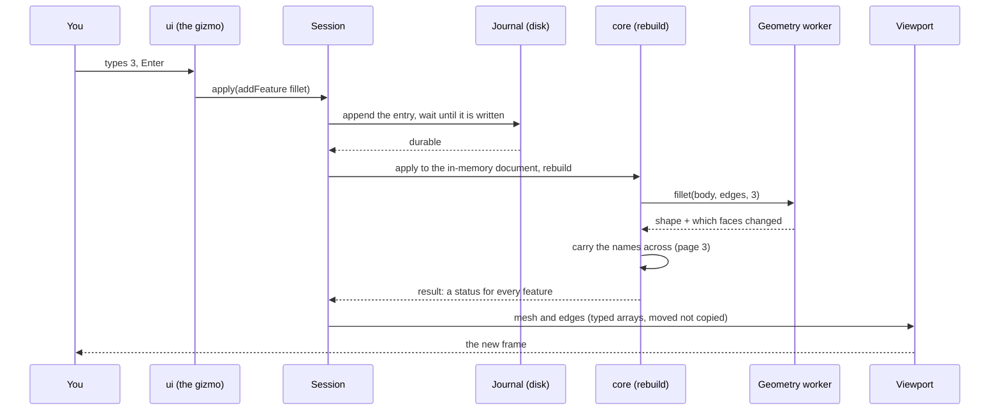

# 1 · The path of one change

You select an edge and type a fillet radius of 3 mm. About a hundred milliseconds
later the part is rounded on screen. This page follows that change from the key press
to the picture, in the order things happen, and says why the order is what it is.

## 1. Record, then apply

`Session` (`apps/studio/src/session.ts`) holds one open document. Its rule, which its
own header calls non-negotiable: **record, then apply.** `DocumentStore.record` writes
the journal entry and waits until it is on disk before the operation touches the
in-memory document. If the app dies in between, the next open replays that line and
arrives at the same place. What a crash can cost is **one edit**, never an autosave
interval. Why this ordering, and what "on disk" means, is [page 4](04-storage.md).

An edit is an **`Operation`** (`addFeature`, `updateParams`, `renameDocument` ...), not
a new copy of the document. That is also what makes undo cheap: `undo` writes the
inverse operation (`invert`) to the journal like any other edit, and the undo and
redo steps are kept beside the document so that Undo still works after reopening it.

## 2. Rebuild only what changed

A document is a **history of features**, not a solid. The solid is what you get by
replaying the history through the geometry engine. `core` rebuilds with a cache keyed
per feature, so the features before the one you changed are cache hits, and only that
one and the ones after it run again.

Measured on 2026-10-02 ([`benchmarks.md`](../benchmarks.md)): changing the **last**
feature of a 40-step history rebuilds in 35 ms, against 617 ms for a full rebuild
(17.6 times faster). Changing the **first** feature costs the full 617 ms, because
everything after it depends on it. A change that fails does not lose the rest: every
feature carries its own status (`ok`, `failed`, `dangling`, `blocked`), so one broken
step is marked and the part before it is still there.

Before a change is committed, `Session` can try it (`#trial`, `previewApply`,
`partPreview`): a fillet dragged out with the pointer is drawn live without writing
anything, and written once on release.

## 3. The geometry runs somewhere else

The rebuild asks the kernel to do the work, and the kernel is not on the page's main
thread. OCCT runs in a **supervised Web Worker**, so a boolean that takes 400 ms is a
pause in the part, not a frozen cursor. How that worker is kept alive is
[page 2](02-geometry-engine.md). What comes back is not only the shape but **which
faces the operation modified, generated and deleted**, which is the raw material for
[page 3](03-stable-references.md).

## 4. The picture

The result reaches the viewport as flat typed arrays (positions, triangles, edge
polylines), moved across the worker boundary rather than copied. The viewport redraws
on demand, not on a timer ([page 5](05-viewport.md)). On the first solid of a new
project, measured by phase in Chromium: **100 ms** for the change itself, of which 78 ms
is the rebuild, 13 ms the write to disk, 7 ms the history and 2 ms the display.

## Where to look

| What | File |
| --- | --- |
| The session, and "record, then apply" | `apps/studio/src/session.ts` |
| The journal and the store | `packages/storage/src/store.ts`, `journal-file.ts` |
| Rebuild, the feature registry | `packages/core/src/` (`features/` has one file per kind of feature) |
| The worker | `packages/kernel/src/worker/` |
| The reasons | [ADR 0007](../adr/0007-performance-architecture.md), [0008](../adr/0008-feature-registry.md), [0009](../adr/0009-durability.md) |
