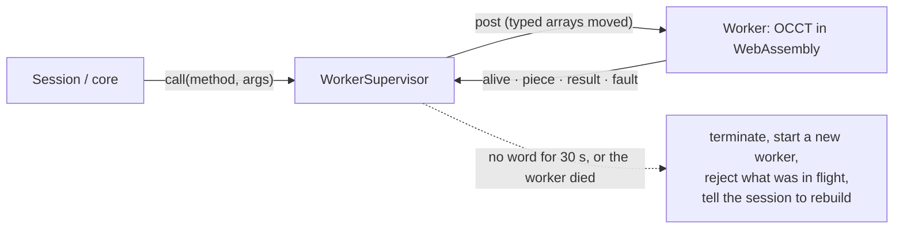

# 2 · The geometry engine and its watchdog

All geometry in Bezier is done by **Open CASCADE (OCCT)**, a thirty-year-old industrial
kernel, compiled to WebAssembly (`occt-wasm`). It is excellent, and it can hard-abort:
out of memory, an internal assertion, a stack overflow on pathological geometry. In
WebAssembly an abort is not an exception that can be caught. It kills the instance.

On the page's main thread that would be a dead application. So the engine lives in a
**Web Worker**, and a small class called the supervisor turns "the worker died" into
"a pause".

## Two ways in, one contract

`createKernel()` (`@bezier/kernel`) gives the supervised worker in a browser and the
engine in-process in Node; `createOcctKernel()` (`@bezier/kernel/occt`) is the direct
one. Both implement `GeometryKernel`, so nothing above can tell which it has. That is
also why the **tests run against the real engine**, not a mock: a mocked kernel proves
nothing (see [`contributing/testing.md`](../contributing/testing.md)).

## The supervisor (`packages/kernel/src/worker/supervisor.ts`)

It knows nothing about the browser's `Worker`; it talks to a small `SupervisedWorker`
interface, so its behaviour under crashes and hangs is tested against fakes that
crash and hang on demand.

| Rule | Value | Why |
| --- | --- | --- |
| A call may be silent for | **30 s** | After that the worker is presumed wedged and is replaced |
| Silence, not duration | the worker sends `alive` and `piece` messages | Meshing a large assembly takes longer than any deadline short enough to catch a real hang, so the clock is **restarted by every sign of life**, for every call waiting |
| One method may kill the worker | **twice** | The third time it is **refused** with a message, instead of an endless restart loop that never recovers enough to tell you anything |
| Importing a STEP file | **30 s + 3 s per megabyte**, at most 30 min | Measured: about 1.1 MB of STEP per second; a 97 MB file took 87 s. A fixed 30 s restarted the engine halfway through every large file (`budget.ts`) |
| After a restart | the session is told, and rebuilds | You see *"The geometry engine stopped and was restarted. This operation was not completed."* and everything before it is intact |

## Failure is a value

No kernel function throws for a geometry failure; each returns a `KernelResult<T>`, and
the type system makes the caller handle the failure case. A fillet that cannot be built
marks **one feature** as failed ([page 1](01-the-path-of-a-change.md)); it does not take
the document down. A restart is the same idea one level up.

## What this cost to learn

Facts established by experiment and written down because guessing wrong is expensive
(the long list is in [`kernel.md`](../kernel.md#facts-that-are-easy-to-get-wrong); the spikes are in `tools/spikes/`):

- **Never hand OCCT a whole assembly to mesh, outline or bound.** On a 1715-solid
  compound meshing fails, an outline takes over ten minutes and exact bounds a minute;
  solid by solid it is seconds.
- **Fillet and chamfer work one solid at a time**, and refuse a compound outright,
  even a compound of one solid.
- **OCCT never meshes a shape coarser than it already is**, so a coarser request quietly
  returns the old mesh; the code meshes a copy.
- **Face hashes are not stable** across rebuilds. That is the whole reason for
  [page 3](03-stable-references.md).

## Known limit

The first call to a fresh worker includes loading and compiling the engine's WebAssembly
(about 4.7 MB), with nothing reporting progress meanwhile, inside the same 30 s. On a
healthy machine that is a fraction of a second (cold kernel load measured at 78 ms,
[`benchmarks.md`](../benchmarks.md)); on a two-core runner shared with a second browser,
the watchdog fired ten times on a box extrude (2026-10-01, [`contributing/ci.md`](../contributing/ci.md)). How close a
very slow machine comes to the limit has not been measured yet.

## Where to look

`packages/kernel/src/` (`kernel.ts` the contract, `occt-kernel.ts` the engine and its
documented workarounds, `worker/` the supervisor, `budget.ts`, `tessellation.ts`),
[ADR 0001](../adr/0001-geometry-kernel.md), [ADR 0009](../adr/0009-durability.md).
