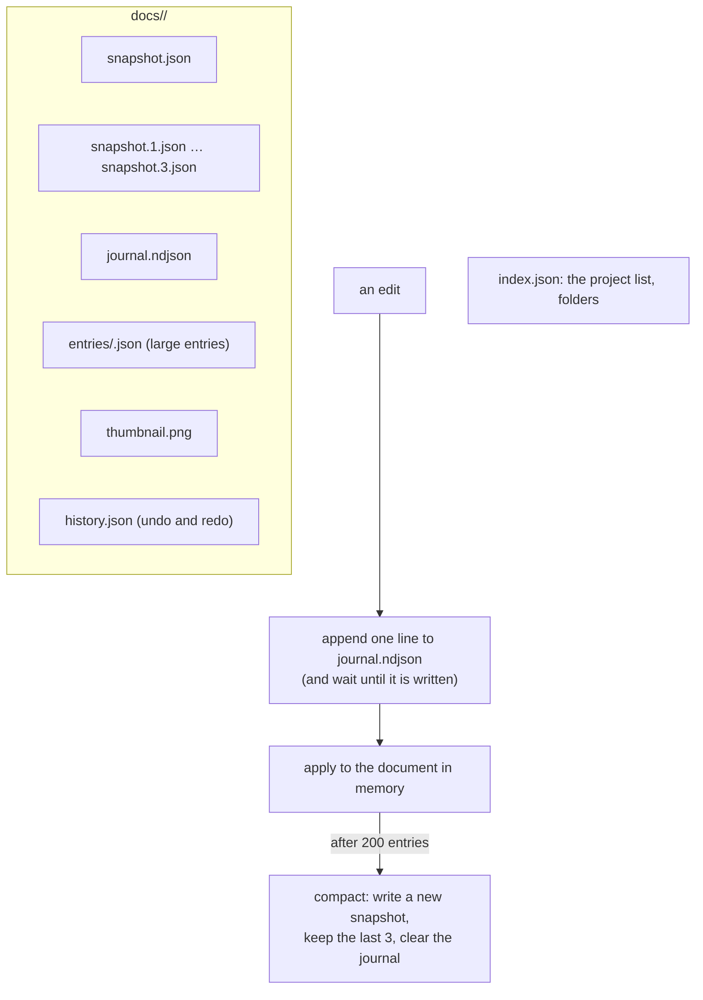

# 4 · What is written to disk

Everything stays on your machine: no account, no upload, no server. A project is not a
file you save; it is a **journal** that is appended to on every edit, plus a snapshot to
open quickly from.

## The write path

1. **Append** the operation to the journal (atomically).
2. Wait until it is written.
3. Only then **apply** it to the document in memory.

If the app dies between 2 and 3, the next open replays the line and arrives at the same
place. What a crash can cost is **one operation**, not an autosave interval
([ADR 0009](../adr/0009-durability.md)). The one structure, an append-only log, gives
crash safety, the cheapest possible write, undo and a replayable bug report at once.

## Opening a project

`DocumentStore.load` reads the newest snapshot that is readable (it falls back through
the three previous ones) and replays the journal on top. **Damage degrades, it does not
fail**: a journal that is broken at entry 400 loads the first 399 entries and says what
happened, rather than refusing to open.

## The files (`packages/storage/src/backend.ts`)

| File | What |
| --- | --- |
| `docs/<id>/snapshot.json`, `snapshot.1.json` … | The document as of the last compaction, and up to three before it |
| `docs/<id>/journal.ndjson` | One JSON object per line: every edit since the snapshot |
| `docs/<id>/entries/<seq>.json` | An entry too large for a line (over 64 KB, such as an imported STEP file), written first, named by a short line in the journal |
| `docs/<id>/thumbnail.png` | The picture on the start page's card, taken as you leave the project |
| `docs/<id>/history.json` | The undo and redo steps, so Undo still works after reopening |
| `index.json` | The project list and the folders, changed one cycle at a time (queued, so two quick edits cannot overwrite each other) |

Large entries are kept apart for a measured reason (`journal-file.ts`): appending to a
file in OPFS copies the whole file first. In WebKit, appending to a 1 MB journal took
9 ms, to 50 MB 85 ms, to 250 MB 310 ms. A project holding a 241 MB assembly paid a third
of a second, and wrote a quarter of a gigabyte to disk, on every edit. Now the journal
stays small however large the project grows.

## Where the bytes go: three backends

Storage is behind a five-method interface (`write`, `append`, `read`, `list`, `remove`)
so the same logic serves every platform. At start the app picks, in this order
(`apps/studio/src/boot.ts`):

| Backend | Used when |
| --- | --- |
| **OPFS** (`OpfsBackend`) | the browser offers it and it opens: Chrome, Safari, the macOS and Windows apps |
| **IndexedDB** (`IndexedDbBackend`) | there is no OPFS, or it would not open. The **Linux app's web view has no OPFS at all**, so this is its normal store, and it keeps a project across closing the app. You are told ("Saving to IndexedDB") only when the browser offered OPFS and it failed. |
| **Memory** | nothing else works. Projects are lost on reload, and the app says so, in red, and keeps saying it |

> **Not built, though an earlier design said it would be:** `packages/storage/README.md`
> once listed "a mirror in a second backend" and "native files on the desktop". Neither
> exists today. The desktop apps use the same web storage as the browser, so clearing
> the web view's data deletes the projects; a project is not yet a file you can see.

## A race that only a slow machine showed

Leaving a project writes its thumbnail a moment later. A delete in that moment removed the
files, the thumbnail then landed in the emptied folder, and the start page listed a
project that was not there: a folder with a picture in it and nothing else, shown under
its id. It failed two end-to-end tests on a slow CI runner and never on a fast machine
(2026-10-02). The store now **remembers the ids it deleted**, waits for the writes already
on their way before it removes the files, and turns away late thumbnails, history and
edits for a deleted document. The tests that pin it use a backend whose writes are slow.

## Where to look

`packages/storage/src/` (`store.ts`, `journal-file.ts`, `opfs.ts`, `indexeddb.ts`,
`memory.ts`), `apps/studio/src/boot.ts` (the choice), [ADR 0005](../adr/0005-local-first-storage.md),
[ADR 0009](../adr/0009-durability.md).
