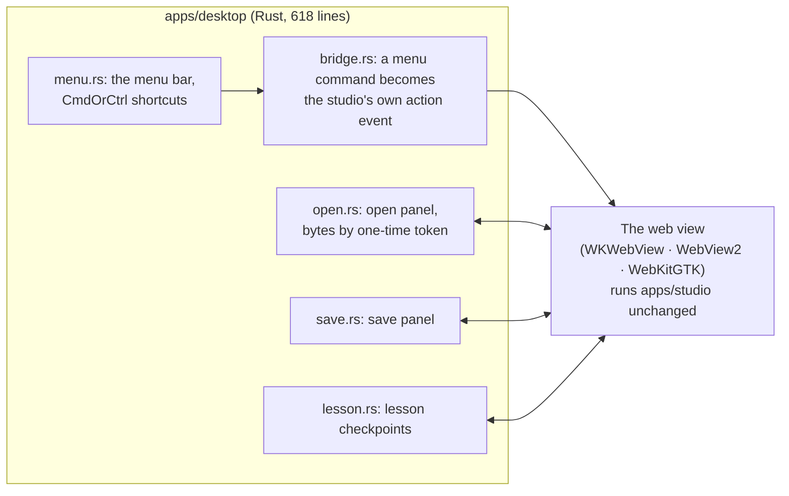

# 6 · The desktop apps

One application, four ways to run it. The desktop builds do **not** fork the editor:
[Tauri 2](../adr/0006-desktop-packaging.md) loads the built `apps/studio` in the system's
own web view, and a small Rust program owns only what the operating system does better.

## What is native, and what is not

| Native (Rust) | Not native, on purpose |
| --- | --- |
| The application menu and its shortcuts (`CmdOrCtrl+Z`, `+D`, `+,` ...) | The editor, every command, every document: the same code as in a browser |
| The window frame; on macOS an overlay title bar with the traffic lights | The viewport, the geometry engine, storage |
| The open and save panels (run on a blocking task: a modal panel needs the main thread, and blocking it on one hangs the app) | |
| Files opened from Finder (macOS only: that event exists only on Apple systems) | |

The bridge is thin (`bridge.rs`): **a native menu command is turned into the
same DOM event as its keyboard or title-bar equivalent**, so each action has one
implementation. This keeps the desktop app from becoming a fork.

## How files cross the boundary

The page never names a path. A file you choose in the open panel is remembered in Rust
under a **one-time token**; the page asks for the bytes by token (`read_import`) and the
token works once. A page that could ask for any path would be a way to read the whole
disk. Bytes travel **raw**, not as base64 inside JSON: a 241 MB STEP file used to become
321 MB of text, parsed and decoded a character at a time before the import started.
Limits: 256 MB per imported file, 512 MB for what the page may save in one call, 20 MB
for a lesson checkpoint, which is validated as JSON before it is handed over.

The page's own content-security policy allows scripts from itself and WebAssembly
(`wasm-unsafe-eval`), workers from itself and from blobs, and nothing from elsewhere
(`tauri.conf.json`). Both `.wasm` files stay separate, runtime-loaded files, never inlined
(the LGPL relinking requirement, [ADR 0003](../adr/0003-license-model.md)).

## The same app in three web views

| | macOS | Windows | Linux |
| --- | --- | --- | --- |
| Web view | WKWebView | WebView2 (Chromium) | WebKitGTK |
| Installer | `.app`, `.dmg` (from macOS 13) | NSIS, per user | `.deb` |
| Project storage | OPFS | OPFS | **IndexedDB** (no OPFS in this web view) |
| Lesson recording | yes | expected, not tested | only if the machine has a video encoder; the Record sheet tests it |
| Needs | | | a D-Bus session (GTK waits 25 s for one before it shows the window) |

What is *tested* where is in [`platforms.md`](../platforms.md). The gap, from
[ADR 0005](../adr/0005-local-first-storage.md): **documents are not yet files.** The
desktop apps use the browser's storage inside the web view, so clearing the web view's
data deletes projects. Swapping in a native-file backend is why storage is behind an
interface; it has not been written.

Builds are unsigned; `release.yml` builds installers for all three systems by hand, and
signs them only if signing secrets are set.

## Where to look

`apps/desktop/src-tauri/` (`tauri.conf.json`, `src/`), [ADR 0006](../adr/0006-desktop-packaging.md),
[`apps/desktop/README.md`](../../apps/desktop/README.md).
