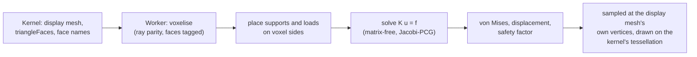

# 7 · Simulation and lessons

Two workspaces that are not modelling. Both are real, both are younger than the rest, and
and what is built is said below.

## Simulation

**Built (phase 1):** static stress on a body, and shape optimisation. You fix faces, load
faces (a force or a pressure), solve, and read the stress or displacement on the part
itself. **Designed, not built:** phases 2 to 4 (a better preconditioner, tetrahedral
meshes and a CalculiX sidecar on the desktop) are in `docs/simulation/ARCHITECTURE.md`
and [ADR 0011](../adr/0011-simulation-workspace.md) and say so.

- **It runs in a worker** (`sim-worker.ts`), in TypeScript with no dependencies
  (`packages/sim`): a voxel grid, trilinear hexahedra, a matrix-free conjugate-gradient
  solve. A medium study (about 24,000 elements) solves in seconds; fine and ultra take
  minutes until the planned better preconditioner.
- **Results never look voxelised**: stress is sampled trilinearly at the display mesh's
  own vertices and drawn on the kernel's tessellation. The staircase exists only inside
  the solver.
- **A study names faces by stable reference** ([page 3](03-stable-references.md)), so it
  survives a re-mesh and most edits. It is kept per project in local storage today; the
  journal comes in phase 2.
- **It is checked against hand calculation** (`sim.test.ts`): a uniaxial bar to solver
  precision (σ = F/A, δ = FL/EA), a cantilever within the band that a linear hexahedron
  can reach of Euler–Bernoulli, and shape optimisation holding volume while lowering
  compliance.
- A study goes stale when the model changes after the solve; the panel says so.

## Lessons

You learn CAD from **recordings you can step into**. A lesson is the editor's viewport as
video, your keys and clicks as events, and **a checkpoint of the model after every edit**,
so any chapter can be opened as a project of your own.

- It is part of the app (`packages/lessons`). The editor talks to it through one interface,
  `LessonHost` (`src/host/contract.ts`), implemented in `apps/studio/src/lessons-host.ts`, so
  Learn does not reach into the editor.
- Recording needs a web view that can record a canvas **and** produce video from it.
  Chromium and Safari can; the Linux app's web view reports it can and may return an empty
  file, so the Record sheet records a small test canvas first and says why it is off if
  nothing comes back.
- A lesson is a file (`.bezierlesson`); the app imports one from the Learn page and plays
  it in the editor, with its chapters.

## Where to look

`packages/sim/`, `apps/studio/src/simulation/`, `docs/simulation/ARCHITECTURE.md`,
`packages/lessons/`, `apps/studio/src/lessons-host.ts`.
