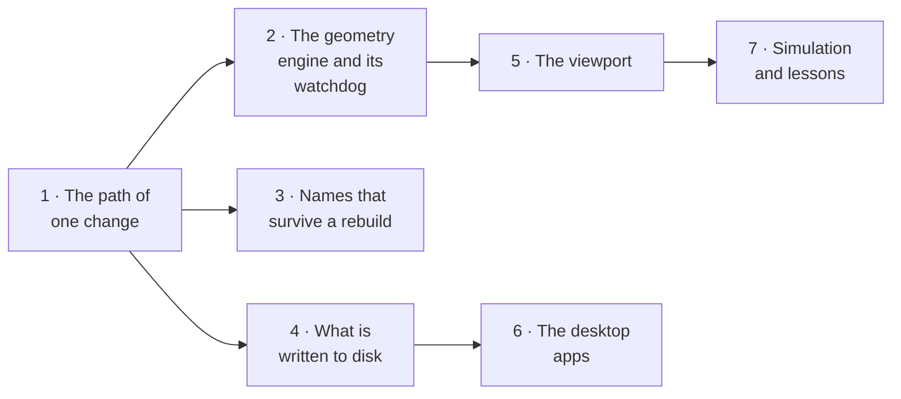

# How it works

Bezier from the inside, for someone who has not read the code and for someone who is
about to. Each page is one question, answered against the code as it is today (the
files it names are the ones to open next). Where the code does less than a design
document once promised, the page says so.

Start with [the overview in `ARCHITECTURE.md`](../architecture.md) if you want the
shape in one page; these pages go deeper.

| Page | The question |
| --- | --- |
| [1 · The path of one change](01-the-path-of-a-change.md) | You drag a fillet radius. What happens, in what order, and why that order? |
| [2 · The geometry engine and its watchdog](02-geometry-engine.md) | OCCT can crash. What stops that from costing you your work? |
| [3 · Names that survive a rebuild](03-stable-references.md) | After a rebuild, how does the fillet still know which edge it was on? |
| [4 · What is written to disk](04-storage.md) | Where does a project live, what is in it, and what happens on a crash? |
| [5 · The viewport](05-viewport.md) | How does a click become "that face", and how does it stay fast? |
| [6 · The desktop apps](06-desktop-apps.md) | What is native on macOS, Windows and Linux, and what is not? |
| [7 · Simulation and lessons](07-simulation-and-lessons.md) | The two workspaces that are not modelling. |

## Three rules that hold it together

1. **Dependencies point downward only**, enforced by lint (`biome.json`):
   `apps/studio` → `ui` → `renderer` → `core` → `kernel` and `solver`.
2. **The geometry kernel and the solver are each imported in exactly one package**
   (`occt-wasm` in `kernel`, planegcs in `solver`). Both are swappable and both are
   LGPL; one home each keeps a replacement cheap and the licence obligations in a
   known place ([ADR 0003](../adr/0003-license-model.md)).
3. **Geometry failures are values, not exceptions** (`KernelResult`). A fillet that
   cannot be built marks one step as failed; it does not take the document down.
