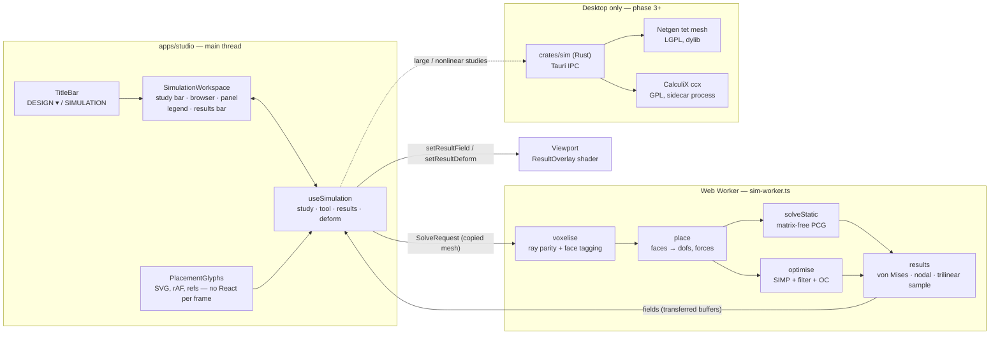
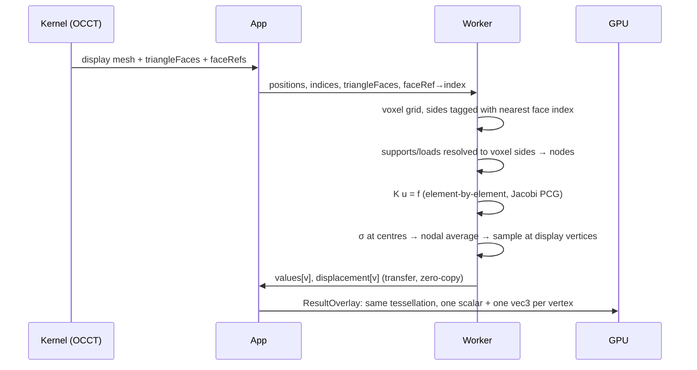

# Simulation workspace: architecture

Status: phase 1 shipped (static stress, shape optimisation, voxel solver in
a worker, results on the B-Rep). Phases 2–4 below are designed, not built.
Decision record: [ADR 0011](../adr/0011-simulation-workspace.md).

## 1. System



The study names faces by stable reference (`F:extrude-1:end`). Nothing in a
study refers to a mesh: re-meshing and most model edits re-resolve references
against the new boundary, and the user's setup survives.

## 2. The bridge from B-Rep to solver and back



Why results never look voxelised: stress is sampled **trilinearly at the
display mesh's own vertices**, then drawn on the kernel's tessellation. A vertex
that falls a hair outside every solid voxel hands over to its nearest solid
neighbour. The staircase exists only inside the solver.

Why pressure is exact on a staircase: summed over the axis-aligned voxel sides
of a face, `n·A` reproduces the true area vector (divergence theorem), so the
resultant force is right on inclined faces too. Force loads are split by side
count, so the resultant equals the typed value exactly.

## 3. Solver core (`packages/sim`, TypeScript, zero dependencies)

| Module | Role |
| --- | --- |
| `voxel.ts` | Grid sized from the bounding box and a target element count; solid by ray parity (ray nudged off shared edges); exposed sides tagged by nearest-triangle search in a spatial bin. |
| `hex8.ts` | One trilinear hexahedron, 2×2×2 Gauss. For edge `h`, `K(h) = h·K(1)`. |
| `solve.ts` | `place()` maps constraints/loads onto dofs; `solveStatic()` is matrix-free Jacobi-PCG with per-element scale (SIMP) and warm start. Non-positive curvature stops the solve and reports an unheld part. |
| `results.ts` | Centre stress, von Mises, nodal averaging, safety factor, trilinear sampling. |
| `simp.ts` | Density filter (radius in elements = minimum member), OC update with bisection on the volume multiplier, non-design shell on every face a study uses. |

Verified by `sim.test.ts` against hand calculations: uniaxial bar to solver
precision (σ = F/A, δ = FL/EA), element symmetry and rigid-body null space,
cantilever within the linear-hex band of Euler–Bernoulli, box voxelisation with
exact face tagging, SIMP holding volume while lowering compliance.

Cost per CG iteration is ~576·2 flops per element. Medium (24 k elements)
solves in seconds in a worker; fine and ultra are minutes until phase 2's
multigrid preconditioner.

## 4. UI state

`useSimulation` owns everything; components are pure views of it.

```ts
interface SimulationState {
  study: Study;                  // persisted per project (localStorage; journal in phase 2)
  tool: SimTool | null;          // fixed | pin | frictionless | force | pressure
  editing: Placement | null;     // what the right-hand panel edits
  progress: Progress | null;     // stage, fraction from log10(residual), detail
  result: SimulationResult | null;
  stale: boolean;                // study or geometry changed since the solve
  quantity: 'vonMises' | 'displacement' | 'safety' | 'density';
  bands: number;                 // 0 smooth, 10 contours
  deform: 'off' | 'actual' | 'adjusted';   // adjusted: max displacement = 6 % of part
  animate: boolean;              // uniform-only animation, no geometry per frame
}
```

Interaction model: choose a support or load in the rail → click faces on the
model → the placement opens in the panel, its faces highlighted → edit values,
direction, held axes → Done (Enter) or Escape. Clicking a face while a
placement is open adds or removes it. ⌘↩ solves from anywhere.

## 5. Rendering (`packages/renderer/src/result-overlay.ts`)

A second mesh over the body's tessellation with a `ShaderMaterial`: engineering
ramp (blue → cyan → green → yellow → red), safety ramp reversed, density grey;
contour bands with **one-pixel lines from `fwidth`**, crisp at any zoom;
displacement applied in the vertex shader, so animation is one uniform. The
body is hidden while results show (no z-fighting); the undeformed edges stay as
the reference outline. Picking keeps running on the model, so loads can be
edited over a result.

WebGPU: the same shader ports to WGSL/TSL when the viewport moves to three's
`WebGPURenderer`. It is not a prerequisite for anything in phases 1–3.

## 6. Parity plan

| Study (Fusion) | Phase | Path |
| --- | --- | --- |
| Static stress | **1 ✓** | voxel hex8, worker |
| Shape optimisation | **1 ✓** | SIMP on the same grid |
| Modal frequencies | 2 | shift-invert Lanczos on the voxel system (lumped mass) |
| Real-time preview | 2 | coarse grid re-solve on every load edit, warm-started |
| Fatigue | 2 | Goodman/Basquin post-processing of static stress with S–N data per material |
| Thermal, thermal stress | 3 | scalar conduction on the same grid: built for steady thermal (`packages/sim/src/thermal.ts`: held temperature, heat in, convection with a lumped film); thermal strain as initial strain is not built |
| Buckling | 3 | geometric stiffness from the static stress, generalised eigenproblem |
| Nonlinear static, contact | 4 | native: CalculiX sidecar on Netgen tet meshes |
| Event simulation | 4 | explicit central-difference on the voxel grid (drop tests) |
| Flow preview (FSI one-way) | 4 | lattice-Boltzmann on the same voxels, surface pressure → load |

Phase 2 also brings: geometric multigrid preconditioner (voxel grids coarsen
trivially, ~10× fewer iterations), studies in the journal (undo, project files),
probes on the result, and an adaptive refinement band near stress peaks.

## 7. Licensing path

| Component | Licence | How it may be used |
| --- | --- | --- |
| `packages/sim`, `crates/sim` | ours | the default path; no third-party code |
| OpenCASCADE | LGPL-2.1 + OCCT exception | as today: separate WASM, replaceable (ADR 0003) |
| Netgen (tet meshing) | LGPL-2.1 | desktop only, dynamically linked, user-replaceable library |
| CalculiX `ccx` | GPL-2.0-or-later | desktop only, **separate process** fed `.inp` files, never linked |
| MFEM | BSD-3-Clause | usable directly if a native FEM library is wanted |
| Kratos | BSD with an advertising clause | usable; advertising material must credit it |
| Gmsh | GPL-2.0-or-later with a linking exception | avoid in-process; sidecar only if needed |
| TetGen | AGPL-3.0 or commercial | do not ship without a commercial licence |

The GPL-as-sidecar route is common practice but its boundary is a legal
question, not an engineering one; it belongs in the legal review the masterplan
already requires before any public release.

## 8. What else this makes possible

- **Print-aware results**: orthotropic material with a weaker build axis, so the
  study answers "which way should I print this".
- **Load from the model**: a screw boss knows its screw; bolt preload and
  bearing loads offered on cylindrical faces automatically.
- **Optimisation back to CAD**: SIMP density → iso-surface → mesh body, then
  guided re-modelling with the result as a ghost.
- **Lessons**: a study is data plus a journal, so the education capture format
  can replay "place a load, solve, read the result" step by step.
